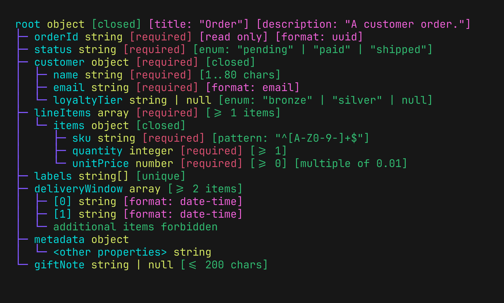

# Puu

[](https://crates.io/crates/puu)

Render JSON Schema for humans 🌳

## About

A CLI that transforms JSON Schema into readable terminal views.
Built for understanding, sharing, and documenting schemas — not validating instances.

```
$ puu ./tests/fixtures/render/order-model.json
root object [closed] [title: "Order"] [description: "A customer order."]
├─ orderId string [required] [read only] [format: uuid]
├─ status string [required] [enum: "pending" | "paid" | "shipped"]
├─ customer object [required] [closed]
│  ├─ name string [required] [1..80 chars]
│  └─ email string [required] [format: email]
└─ ...
```



For more input examples and their rendered output, see the [fixture output catalog](docs/render-fixtures.md).

## Installation

### [Cargo](https://crates.io/crates/puu)

```
cargo install --locked puu
```

### Downloading a binary

Pre-built binaries are available from the [releases page](https://github.com/lusingander/puu/releases).

## Usage

```
puu [OPTIONS] <SCHEMA>
```

`SCHEMA` is the path or HTTP(S) URL of a JSON Schema, or `-` to read from standard input.

```sh
# Render a local schema file
puu schema.json

# Fetch and render a schema from a URL
puu https://json.schemastore.org/package.json

# Read a schema from standard input using '-'
puu - < schema.json
```

### Options

```
Puu - Render JSON Schema for humans 🌳

Usage: puu [OPTIONS] <SCHEMA>

Arguments:
  <SCHEMA>  JSON Schema file or URL to render, or '-' to read from standard input

Options:
  -d, --draft <DRAFT>        Override the JSON Schema draft [possible values: 2020-12, 2019-09, 7]
  -p, --pointer <POINTER>    Render the schema at a JSON Pointer
  -L, --max-depth <N>        Limit display tree depth, counting the root as depth 0
  -W, --max-width <N|auto>   Limit output width in terminal columns, or 'auto' for terminal width
  -l, --layout <MODE>        Arrange output as separate sections or a single tree [default: sections] [possible values: sections, tree]
  -D, --definitions <MODE>   Control which definitions are displayed [default: all] [possible values: all, referenced, none]
  -r, --expand-refs          Expand locally resolved schema references
  -a, --exclude-annotations  Hide schema annotations
  -v, --verbose              Show full annotations and uninterpreted values
  -c, --color <COLOR>        Control colored tree output [default: auto] [possible values: auto, always, never]
  -h, --help                 Print help
  -V, --version              Print version
```

For concrete inputs, rendered images, and interaction details for every option, see the [CLI option guide](docs/options.md).

### Supported scope

Puu renders JSON Schema Draft 2020-12, 2019-09, and Draft 7. See [Supported scope](docs/supported-scope.md) for supported keywords and limitations.

## License

MIT
