# CLI Options

This guide shows how each output-related Puu option changes the rendered tree. The images are generated from the real CLI with [Freeze](https://github.com/charmbracelet/freeze).

Run the following command from the repository root to update the images:

```sh
./scripts/generate-option-images.sh
```

## Contents

- [Draft override (`-d` / `--draft`)](#draft-override)
- [JSON Pointer selection (`-p` / `--pointer`)](#json-pointer-selection)
- [Maximum display depth (`-L` / `--max-depth`)](#maximum-display-depth)
- [Maximum output width (`--max-width`)](#maximum-output-width)
- [Output layout (`-l` / `--layout`)](#output-layout)
- [Definition display (`-D` / `--definitions`)](#definition-display)
- [Reference expansion (`-r` / `--expand-refs`)](#reference-expansion)
- [Annotation display (`-a` / `--exclude-annotations`)](#annotation-display)
- [Verbose output (`-v` / `--verbose`)](#verbose-output)
- [Color output (`-c` / `--color`)](#color-output)
- [Help (`-h` / `--help`)](#help)
- [Version (`-V` / `--version`)](#version)

## Draft override

`-d DRAFT` / `--draft DRAFT` interprets the entire input as the selected JSON Schema draft, overriding its `$schema` declaration when present. The supported values are `2020-12`, `2019-09`, and `7`. Without this option, Puu uses the declared draft or assumes Draft 2020-12 when `$schema` is absent.

The example contains dependency keywords from both the modern drafts and Draft 7:

```json
{
  "type": "object",
  "dependencies": {
    "legacy": ["oldTarget"]
  },
  "dependentRequired": {
    "modern": ["newTarget"]
  }
}
```

[Example input](examples/options/draft.json)

With Draft 2019-09, the modern dependency keywords are interpreted and `dependencies` is left uninterpreted:

```console
puu --draft 2019-09 docs/examples/options/draft.json
```

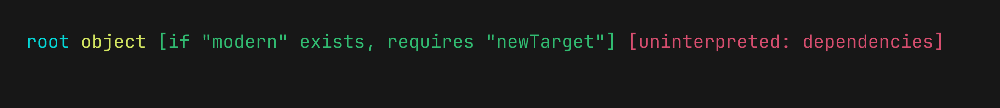

With Draft 7, `dependencies` is interpreted and the newer keywords are left uninterpreted:

```console
puu --draft 7 docs/examples/options/draft.json
```

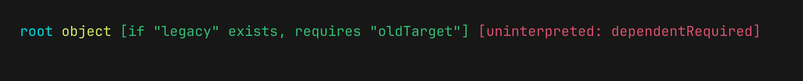

The override applies to embedded resources as well as the document root. It can therefore make an input invalid when a keyword has a different shape in the selected draft.

## JSON Pointer selection

`-p POINTER` / `--pointer POINTER` renders a schema at a particular location instead of starting at the document root. It accepts `#`, URI fragment JSON Pointers such as `#/$defs/User`, and JSON Pointers without the fragment marker such as `/$defs/User`.

```json
{
  "type": "object",
  "properties": {
    "orderId": { "type": "string" }
  },
  "$defs": {
    "User": {
      "type": "object",
      "required": ["name"],
      "properties": {
        "name": { "type": "string" },
        "email": { "type": "string", "format": "email" }
      }
    }
  }
}
```

[Example input](examples/options/pointer.json)

```console
puu --pointer '#/$defs/User' docs/examples/options/pointer.json
```

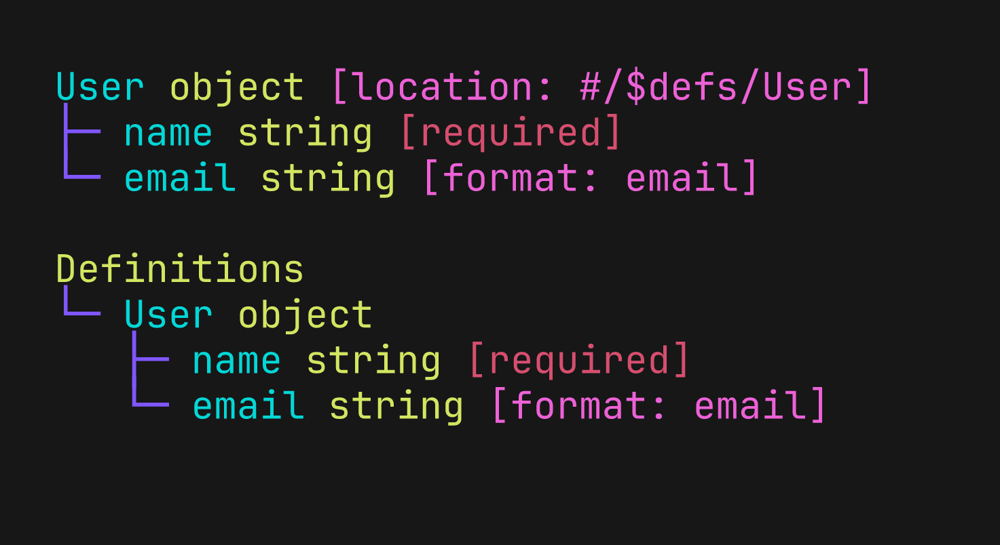

The selected node is labeled with its document location. Definitions are still displayed according to `--definitions`; the default `all` mode explains why `User` also appears in the separate `Definitions` section above. With `--definitions referenced`, reference traversal starts at the selected schema.

Quote pointers beginning with `#` so that the shell does not treat the value as a comment. A pointer must identify a schema rather than an arbitrary JSON value such as a `$ref` string.

## Maximum display depth

`-L N` / `--max-depth N` limits the indentation depth of every rendered tree, counting each root as depth 0. It keeps nodes at the limit and replaces their children with an explicit omission marker.

```json
{
  "type": "object",
  "properties": {
    "customer": {
      "type": "object",
      "properties": {
        "name": { "type": "string" },
        "address": {
          "type": "object",
          "properties": {
            "city": { "type": "string" }
          }
        }
      }
    },
    "status": { "type": "string" }
  }
}
```

[Example input](examples/options/max-depth.json)

```console
puu --max-depth 1 docs/examples/options/max-depth.json
```

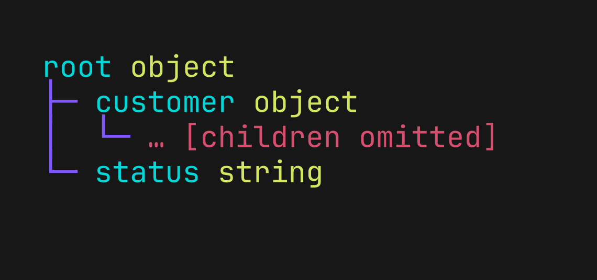

A leaf at the limit is unchanged because it has no children to omit. Expanded reference targets and nodes in the separate `Definitions` section follow the same depth rule.

With `--layout tree`, the common `Schema` parent is excluded from the depth count. The schema root and the `Definitions` heading remain at depth 0, so switching layouts preserves which nodes are visible.

## Maximum output width

`--max-width N` limits each output line to at most `N` terminal columns, including indentation, tree connectors, and the trailing `..` used for truncation. `N` must be an integer of at least 2. Without the option, no line width limit is applied; Puu does not automatically detect terminal width.

```json
{
  "type": "object",
  "properties": {
    "email": {
      "type": "string",
      "format": "email",
      "description": "Primary contact address used for account notifications."
    },
    "status": {
      "type": "string",
      "enum": ["pending", "active", "disabled"]
    }
  }
}
```

[Example input](examples/options/max-width.json)

```console
puu --max-width 48 docs/examples/options/max-width.json
```

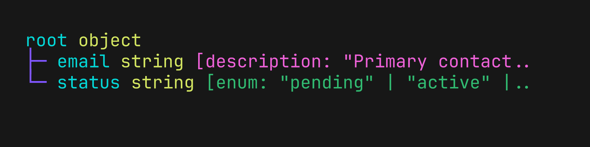

Lines that fit are unchanged. Longer lines are shortened at the end without wrapping, so constraints and annotations beyond the limit may be omitted. Width is measured in display columns rather than bytes or character count: Japanese text uses wide columns, ANSI color codes take no columns, and truncation preserves combining characters and emoji sequences.

The limit applies to both layouts, including the `Schema` heading and the `Definitions` block. Narrow widths can truncate the indentation itself, but every node still produces a line. Explicit limits also apply when output is piped or redirected to a file.

`--verbose` still follows the width limit. Existing per-annotation summaries are independent of this option; omitting `--max-width` removes only the line width limit.

## Output layout

`-l MODE` / `--layout MODE` arranges all output blocks. The default `sections` mode separates the schema tree and other blocks with blank lines. The `tree` mode places every block under a common `Schema` parent, including any blocks added in the future.

The example uses the [reference input](examples/options/references.json) shown in the definition display section below.

### Separate sections

`sections` keeps the schema tree and `Definitions` as separate blocks:

```console
puu --layout sections docs/examples/options/references.json
```


### Single tree

`tree` connects the same blocks under one parent:

```console
puu --layout tree docs/examples/options/references.json
```

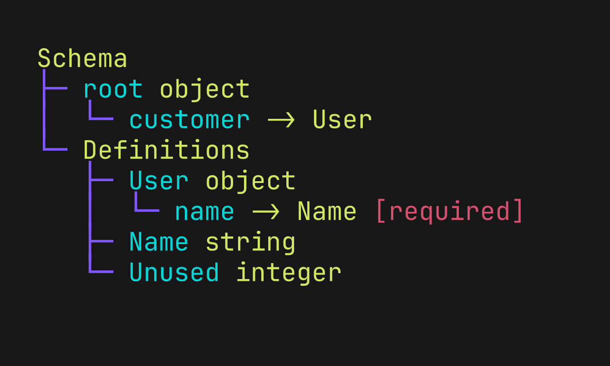

`--definitions` controls which definitions are included in either layout. When no definitions are displayed, `tree` still places the schema root under `Schema`. The parent label is the same for file, URL, and standard input.

`--pointer` still selects the schema shown in the first block and keeps its location label. Reference expansion and annotation options apply to the same nodes in either layout. The common parent does not count toward `--max-depth` or reference expansion limits.

## Definition display

`-D MODE` / `--definitions MODE` controls the `Definitions` block in either layout. The default mode is `all`; the other modes are `referenced` and `none`.

The example references `User`, which in turn references `Name`, while `Unused` is not referenced:

```json
{
  "type": "object",
  "properties": {
    "customer": { "$ref": "#/$defs/User" }
  },
  "$defs": {
    "User": {
      "type": "object",
      "required": ["name"],
      "properties": {
        "name": { "$ref": "#/$defs/Name" }
      }
    },
    "Name": { "type": "string" },
    "Unused": { "type": "integer" }
  }
}
```

[Example input](examples/options/references.json)

### All definitions

`all` displays every definition and is the default:

```console
puu --definitions all docs/examples/options/references.json
```

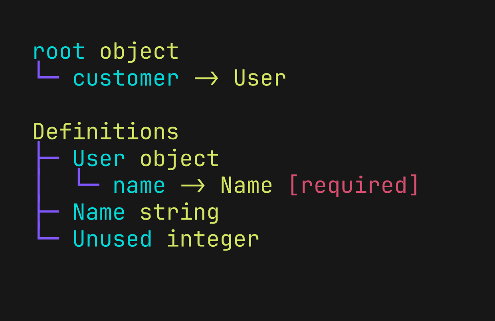

### Referenced definitions

`referenced` displays definitions transitively reachable from the rendered schema. `Unused` is omitted, but `Name` remains because `User` references it:

```console
puu --definitions referenced docs/examples/options/references.json
```

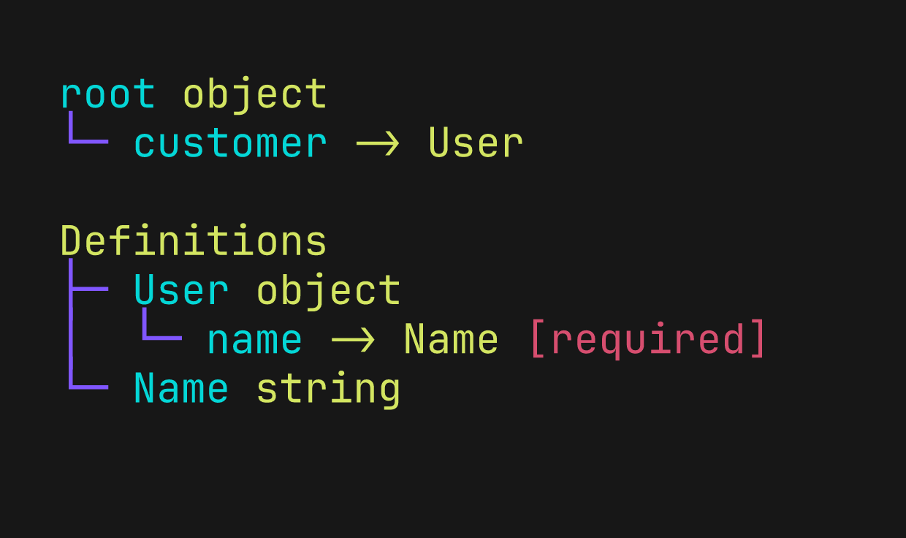

### No definitions

`none` removes the definitions block without hiding references in the rendered schema:

```console
puu --definitions none docs/examples/options/references.json
```

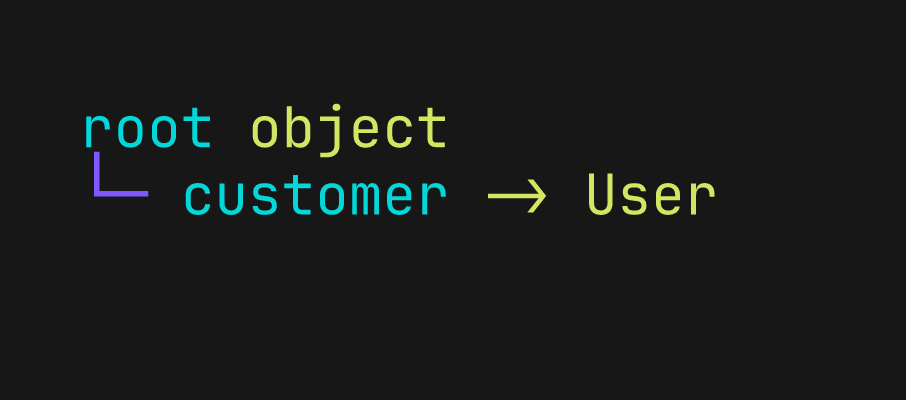

With `--pointer`, traversal in `referenced` mode starts at the selected schema. Definition selection follows references independently of `--max-depth`.

## Reference expansion

`-r` / `--expand-refs` adds the locally resolved target below each reference line. The reference remains visible with its own constraints and annotations, while the target is marked with `[expanded from $ref]`.

This example uses the same [reference input](examples/options/references.json) as the definition modes above. Without expansion, and with the separate definitions section hidden, only the reference is displayed:

```console
puu --definitions none docs/examples/options/references.json
```


Adding `--expand-refs` follows the reference chain from `User` to `Name`:

```console
puu --expand-refs --definitions none docs/examples/options/references.json
```

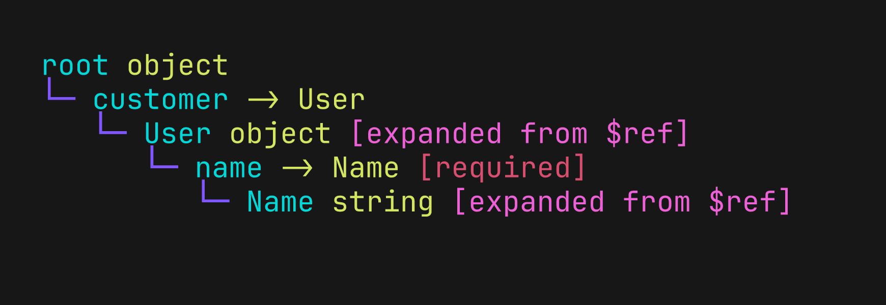

References are expanded transitively and repeated targets are expanded independently in each branch. Targets may be definitions, properties, logical branches, or other schemas in the input document. A reference back to a schema already on the current path is left visible with `[expansion stopped: cycle]`.

`--pointer` selects the starting schema but does not prevent references from reaching other parts of the document. `--definitions` independently controls the definitions block; expansion also applies inside that block when it is displayed. Expanded targets count toward `--max-depth`.

Expansion is bounded to a display depth of 64 and 10,000 constructed expansion nodes across the output, excluding omission markers. Puu marks those boundaries with `[expansion stopped: depth limit]` or `[expansion stopped: node limit]`. External and unresolved references remain visible but are not fetched or expanded.

For locally resolved `$dynamicRef` and `$recursiveRef`, Puu expands the initial target recorded while loading the schema. When dynamic resolution could select a different target, the output includes `[initial target; dynamic scope not evaluated]`.

## Annotation display

Annotations are displayed by default. `-a` / `--exclude-annotations` hides `title`, `description`, `default`, `examples`, `deprecated`, `readOnly`, `writeOnly`, `format`, `$comment`, and the content-related keywords.

The example includes annotations on the root and its properties, plus a `contentSchema` subtree:

```json
{
  "$comment": "Used by schema maintainers.",
  "title": "Order",
  "description": "A customer order.",
  "type": "object",
  "properties": {
    "id": {
      "type": "string",
      "format": "uuid",
      "readOnly": true
    },
    "payload": {
      "type": "string",
      "contentEncoding": "base64",
      "contentMediaType": "application/json",
      "contentSchema": {
        "type": "object",
        "properties": {
          "status": { "type": "string" }
        }
      }
    }
  }
}
```

[Example input](examples/options/annotations.json)

Without the option, the annotations and content schema are part of the output:

```console
puu docs/examples/options/annotations.json
```

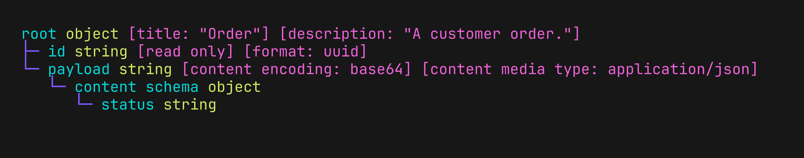

With `--exclude-annotations`, both annotations and the `contentSchema` subtree are omitted:

```console
puu --exclude-annotations docs/examples/options/annotations.json
```

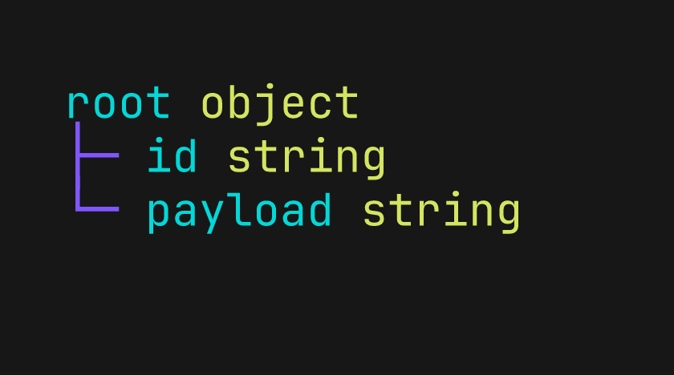

Constraints, schema identity, references, uninterpreted or ignored keyword markers, and metadata such as `$vocabulary` remain visible. Expanded references and definitions use the same annotation setting.

A `contentSchema` is omitted with the annotations unless it is selected directly with `--pointer` or reached as a reference target. In `--definitions referenced` mode, references found only inside an omitted content schema do not make a definition visible. When combined with `--verbose`, annotation exclusion still takes precedence while non-annotation details remain verbose.

## Verbose output

`-v` / `--verbose` shows complete annotation details and the values of uninterpreted keywords. Without it, Puu keeps common output compact by summarizing or omitting those details.

```json
{
  "$comment": "Internal.",
  "type": "string",
  "examples": ["a", "b"],
  "x-ui": { "widget": "text" }
}
```

[Example input](examples/options/verbose.json)

The default output summarizes the example values, omits `$comment`, and reports only the uninterpreted keyword name:

```console
puu docs/examples/options/verbose.json
```

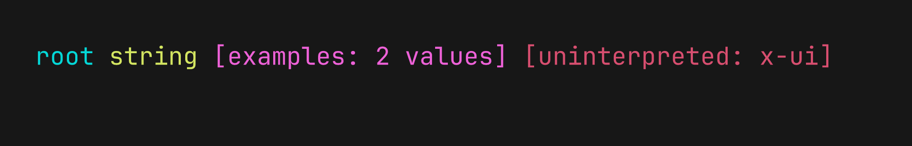

Verbose output includes the complete examples, `$comment`, and the uninterpreted JSON value:

```console
puu --verbose docs/examples/options/verbose.json
```

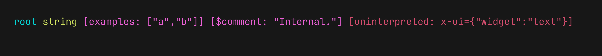

Long annotation text that is truncated in the compact view is also shown in full. `--verbose` does not make Puu interpret unknown keywords; it only reveals their values. When combined with `--exclude-annotations`, recognized annotations remain hidden while metadata and uninterpreted values keep their verbose detail.

## Color output

`-c COLOR` / `--color COLOR` controls ANSI color in the rendered tree. The supported values are `auto`, `always`, and `never`; the default is `auto`.

```json
{
  "type": "object",
  "required": ["id"],
  "properties": {
    "id": {
      "type": "string",
      "minLength": 1,
      "format": "uuid"
    }
  }
}
```

[Example input](examples/options/color.json)

`always` emits color even when output is redirected or piped:

```console
puu --color always docs/examples/options/color.json
```

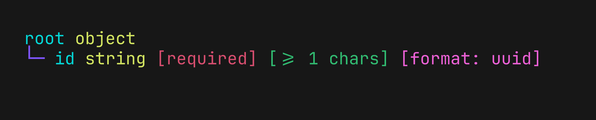

`never` emits plain text:

```console
puu --color never docs/examples/options/color.json
```

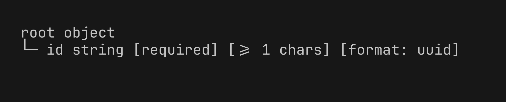

In `auto` mode, Puu follows terminal detection and the color environment. Use `always` when another program in a pipeline must receive ANSI styling, and `never` when writing stable plain-text output. An explicit `always` overrides a disabling environment such as `NO_COLOR`; an explicit `never` overrides a forced-color environment such as `CLICOLOR_FORCE`.

## Help

`-h` / `--help` prints the command synopsis, schema argument, options, defaults, and accepted values, then exits successfully. It does not require a schema argument.

```console
puu --help
```

## Version

`-V` / `--version` prints the `puu` package name and version, then exits successfully. It does not require a schema argument.

```console
puu --version
```
